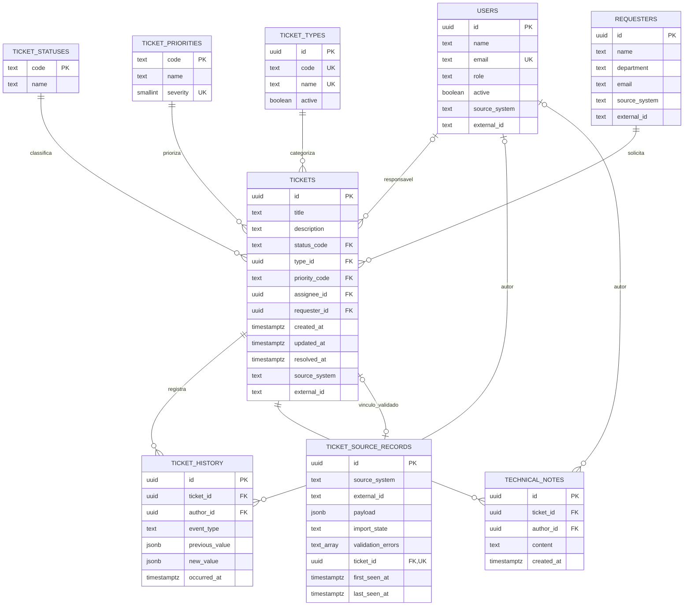

# Modelagem de dados — Fase 2

Modelo implementado nas migrations de `api/migrations`. Domínio: chamados técnicos de helpdesk. Referência de execução: PostgreSQL 18; os testes locais desta fase usam PostgreSQL embarcado via PGlite, sem servidor Docker.

## Modelo lógico



`schema_migrations` é uma tabela técnica do executor, com nome, checksum SHA-256 e instante de aplicação. Não representa uma entidade do domínio e não aparece no diagrama.

## Chaves e relacionamentos

- UUIDs identificam chamados, pessoas, tipos, eventos, notas e registros de origem. O PostgreSQL gera as chaves normais; o seed usa UUIDs determinísticos, sem depender de extensões.
- Status e prioridades usam códigos textuais estáveis. Nomes exibidos ficam em português, separados dos códigos usados nos filtros.
- `tickets` exige solicitante, tipo, prioridade e status; técnico é opcional. Usuários são pessoas da operação com papel de supervisor ou técnico, sem senhas no banco analítico. A validação de que o responsável tem papel de técnico ficará na ingestão/API.
- Nomes de pessoas não são únicos. Em usuários, e-mail informado é único; valores opcionais não são fabricados para satisfazer unicidade.
- Em `users`, `requesters` e `tickets`, o par `(source_system, external_id)` é único quando informado, e seus dois campos devem estar presentes juntos. O mesmo identificador pode existir em origens diferentes.
- Cada registro de origem tem par externo obrigatório e único. `ticket_id` é opcional e único: um registro aceito aponta para um chamado, sem duplicar vínculo. O conector deverá conferir também a igualdade da identidade externa entre as duas tabelas na mesma transação.
- Relacionamentos usam `ON DELETE RESTRICT`: excluir pessoas, chamados ou catálogos referenciados não apaga evidência operacional. Não há endpoint de exclusão previsto. Catálogos e usuários podem ser desativados; desativação não apaga o histórico nem impede consultar registros existentes.

## Constraints e responsabilidades

| Regra | Proteção no banco |
| --- | --- |
| Textos obrigatórios não podem ser vazios | `NOT NULL` e `CHECK btrim(...) <> ''`; título com no máximo 240 caracteres. |
| Catálogos e vínculos válidos | Chaves estrangeiras; códigos de status e prioridade limitados à versão atual. |
| Prioridades com ordem explícita | Severidade única de 1 a 4. |
| Datas coerentes no chamado | Atualização não antecede criação nem resolução; resolução não antecede criação. |
| Conclusão exige resolução | `resolved` e `closed` exigem `resolved_at`; demais status exigem valor nulo. |
| Payload recebido é objeto | `CHECK jsonb_typeof(payload) = 'object'`. |
| Estado da recepção é coerente | `linked` exige chamado e nenhum erro; outros estados não têm vínculo; `rejected` exige pelo menos um erro. |
| Datas de recepção são coerentes | Última observação não antecede a primeira. |
| Histórico usa eventos conhecidos | Criação ou alteração de status, técnico, tipo ou prioridade. |

`previous_value` e `author_id` podem ser nulos: uma criação não possui valor anterior, e uma origem pode não identificar autoria. JSONB guarda o valor do evento, não funciona como substituto dos campos consultáveis do chamado.

As seguintes regras envolvem múltiplas entidades ou transições: ordenação e coerência de eventos com as datas do chamado; responsável com papel de técnico; status anterior consistente; preservação da data ao fechar; remoção da resolução ao reabrir; identidade da origem do vínculo. Não são anunciadas como garantias de `CHECK` entre tabelas. Uma promoção ou alteração de estado precisa validá-las e atualizar chamado e histórico na mesma transação. O conector da Fase 3 apenas preserva legados na recepção; não promove nem altera chamados normalizados, pois o contrato complementar está pendente.

Histórico do Thindesk anterior à observação não será reconstruído a partir de diferenças de snapshots. Um evento detectado pela sincronização precisa distinguir o instante de observação do instante real, se este não vier da origem. Receber um chamado pela primeira vez não comprova seu instante de criação.

## Índices e consultas previstas

| Índice | Uso esperado |
| --- | --- |
| `tickets_created_at_id_idx` | Período de criação e ordenação estável da listagem. |
| `tickets_status_created_at_idx` | Status atual combinado com período de criação. |
| `tickets_type_created_at_idx` | Tipo combinado com período. |
| `tickets_priority_created_at_idx` | Prioridade combinada com período; ordenação por severidade requer junção ao catálogo. |
| `tickets_assignee_created_at_idx` | Responsável combinado com período. |
| `tickets_resolved_at_type_idx` | Série e ranking por resolução, com índice parcial que exclui não concluídos. |
| `ticket_history_ticket_time_idx` | Histórico por chamado, instante e desempate. |
| `technical_notes_ticket_time_idx` | Última consideração e notas por chamado sem varrer toda a tabela. |
| Índices de solicitante e autores | Relações por pessoa e verificação de vínculos sem varrer registros filhos. |
| `ticket_source_records_state_idx` | Acompanhamento de pendências e rejeições por última observação. |

PKs e constraints `UNIQUE` já criam seus próprios índices; não foram duplicados. Não criar um índice para cada combinação possível de filtros. A Fase 3 registrou `EXPLAIN (ANALYZE, BUFFERS)` de quatro consultas com 10 mil chamados sintéticos; ver `evidencias/fase-3-query-plans.json`. As metas de p95 em servidor independente não foram medidas.

## Migrations

1. `001_initial_schema.sql`: nove tabelas do domínio/integração, relacionamentos, constraints, índices e comentários de decisão.
2. `002_ticket_catalogs.sql`: cinco status, quatro prioridades e cinco tipos de helpdesk.

O executor aplica os arquivos em ordem, com transação por migration, checksum e lock de sessão para evitar execuções concorrentes. Reexecutar não reaplica arquivos registrados; alterar uma migration aplicada causa erro. Correções posteriores devem ser novas migrations. Não há rollback destrutivo automático.

## Seed

`api/seeds/001_demo_tickets.sql` insere 480 chamados fictícios, 6 pessoas da operação e 24 solicitantes, com datas espalhadas irregularmente por aproximadamente oito meses, maior concentração recente, tipos e prioridades com pesos diferentes, responsáveis ausentes, notas e movimentações. Alguns chamados possuem resolução anterior e reabertura no histórico; a resolução vigente continua única.

O script não chama `random()`. Com uma data de referência fixa e banco vazio, a massa de domínio é reproduzível. UUIDs determinísticos e `ON CONFLICT DO NOTHING` evitam duplicação e preservam alterações já existentes; mudar a data de referência não desloca registros já criados. Para gerar outro calendário integralmente, usar um novo banco de demonstração.

A referência padrão é a data corrente no fuso da operação. `SEED_REFERENCE_DATE=2026-11-11` reproduz a evidência desta fase. Nunca executar esse seed em uma base com dados operacionais: a ferramenta não remove dados, mas a massa fictícia se somaria aos indicadores.

Os dados de demonstração usam `source_system = demo`. O seed não importa o ZIP nem se conecta ao MongoDB, e não inclui o exemplo legado entre os chamados normalizados.

## Execução

Em PowerShell, partindo da raiz do projeto:

```powershell
Set-Location api
npm.cmd ci
Copy-Item .env.example .env
# Ajustar DATABASE_URL no .env para um banco PostgreSQL vazio e exclusivo do dashboard.
npm.cmd run db:migrate
npm.cmd run db:seed
npm.cmd run test:database
```

Pré-requisitos: Node.js 24 ou superior e PostgreSQL acessível para migrate/seed. `test:database` cria um PostgreSQL embarcado em memória e não usa `DATABASE_URL`. Nenhuma migration é aplicada no MongoDB do Thindesk. O Compose completo com API e frontend pertence à Fase 6.

## Fontes técnicas consultadas

- [PostgreSQL — constraints](https://www.postgresql.org/docs/18/ddl-constraints.html): limitações de `CHECK` entre linhas/tabelas e uso de integridade referencial.
- [PGlite — documentação](https://pglite.dev/docs/): PostgreSQL embarcado e execução de SQL em lote. A validação por rede com PostgreSQL independente foi realizada na [Fase 5](evidencias/fase-5.md), com as mesmas suítes de integridade e API.
